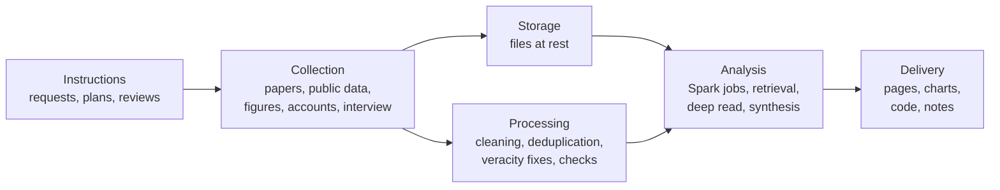

# Pipeline map

This page maps the evidence study behind Nametags as a data pipeline. It starts with the instructions that set the study
going, then follows the data through collection, storage and processing (side by side), analysis, and delivery. It also
says plainly what ran on Spark, and that no Hadoop job ran.

Every count comes from the study's own files. The code that produced them is in [`research/`](../../research/).

**In numbers:** 7,366 records pulled from Europe PMC, 6,816 unique papers, and 5,804 after the veracity fixes; 133,920
rows of CMS nursing-home data; 8 Spark jobs in about 21 seconds; 44 quotes matched word for word in their sources; 20
papers read in depth.

Storage and processing sit side by side: what is collected is kept as files, and it is also cleaned and checked on its
way to analysis.

## 0. Instructions

The study ran on requests from the team, which became three written plans (the plans aren't in the repo). Before each
plan was approved, fresh AI agents (Claude Code) reviewed it.

| Request | Where it went |
|---|---|
| A small data-science study behind Nametags, framed with the course CSCI 436 (Big Data Management and Analytics) | Plan 1, the evidence study |
| Use the conversation with a care-home worker | The interview, under Collection, and [interview themes](interview-themes.md) |
| Find papers and public data | Collection |
| Keep everything in a private notes vault first, and choose what reaches the repo afterwards | Storage |
| Introductions that help the person recall, from a point the care-home worker made | Plan 2, recall-first: cue first, then the name. Designed, not built |
| Map the pipeline, and plan what goes into the repo | Plan 3: this page, the rest of `docs/research/`, `research/`, and the repo's README |

| Plan | What it covered | Reviewed before approval by |
|---|---|---|
| Plan 1 | The evidence study, around four questions: how big the problem is, what carers see, what the research says at scale, and how the evidence fits Nametags as built | 2 agents checking its sources and APIs, and 1 builder check: a fresh agent reads the plan as the person who would carry it out, and lists what's missing |
| Plan 2 | Recall-first introductions | 3 code explorations and 1 design review |
| Plan 3 | This map, and what goes into the repo | 1 review |

**Governance**
- The care-home worker agreed to anonymized use. The repo is public, so it holds only anonymized themes, in our words,
  and never names the worker, the home or any resident.
- No request got around a site's bot block. The quote check reports a site that refuses scripts as unreachable.
- Full abstracts stay out of the repo; the scripts download them again.

## 1. Collection

| What | Source or tool | Where it's stored | Count | Check applied |
|---|---|---|---|---|
| Literature corpus | Europe PMC REST API: 5 queries over titles and abstracts, with no key and no email ([`pull_corpus.py`](../../research/pull_corpus.py)) | `raw/`: one JSON Lines file per theme, and `manifest.json` | 7,366 records; 6,816 unique papers | The pull stops unless it gets exactly each query's hit count, recorded at pull time |
| Yearly totals | The same API: all dementia abstracts per year, 1990 to 2026 | `raw/manifest.json` | One count per year | Used only to normalize growth |
| Nursing-home data | CMS Minimum Data Set Frequency file, Q3 2026, state level; a direct download | `raw/MDS_Frequency_Q3_2026.csv` | 133,920 rows; 54 locations (the states, DC, Puerto Rico, the Virgin Islands and a national row) | Job 6's checks, under Processing |
| Headline figures | Alzheimer's Association *2026 Facts and Figures*, WHO, NCHS, Alzheimer's Society, and 3 Europe PMC abstracts, each re-fetched by an agent | `derived/figures.json` | 13 confirmed | Each figure's sentence fetched again and matched word for word, by script |
| Care-worker accounts | Peer-reviewed studies in Europe PMC, and organizations, searched by 2 agents; 2 more taken from abstracts | `derived/accounts_peer.json`, `accounts_org.json` and `accounts_extra.json` | 22 kept (15, 5 and 2); 3 dropped | Quotes matched word for word, by script |
| Extra quotes | Read from Europe PMC: McCarron et al. 2019, reviews of non-drug approaches, and research on relearning names | `derived/extra_quotes.json` | 13 | Matched word for word, by script |
| Deep-read texts | Europe PMC: 15 papers from the tf-idf reading list (job 4), and 5 picked for open questions about the product | `derived/deep_read_*.json` | 20 papers: 6 in full text, 14 from the abstract | Refuters, a word-for-word check of each supporting sentence, and Crossref |
| Product facts | Nametags as built, read from commits on `main` (52d5a5d, then 0245eb3) | `product.md`, in the study folder only | — | Read from the commits, not from a working copy |
| Interview | A care-home worker's call with a team member, screen-recorded on an iPhone | Not kept with the study | 23 min 31 s of recording | See below |

**The five corpus queries**, pulled 2026-10-25 00:51 EDT. The exact query strings are in
[`raw/manifest.json`](../../research/raw/manifest.json). A first pull was discarded after veracity fix 1, under
Processing.

| Theme | Hits, all pulled | Seconds to pull | Kept after the veracity fixes |
|---|---|---|---|
| Assistive technology | 3,218 | 27.3 | 3,218 |
| Recognizing people | 692 | 6.2 | 692 |
| Care-home staff (qualitative studies) | 1,254 | 15.3 | 1,254 |
| Ethics of technology | 1,064 | 9.2 | 1,020 |
| Truth-telling and deception | 1,138 | 17.3 | 132 |
| **All five** | **7,366** | **75.3** | |
| **Unique papers** | **6,816** | | **5,804** |

### The interview

A care-home worker talked with a team member on a call, which was screen-recorded on an iPhone. The recording held
nothing usable:
- **Audio:** both channels are exact digital silence (RMS -inf dB) for all 23 min 31 s (1,411.1 s), apart from two blips
  of about 0.3 s near 19:06 and 19:15. The likely cause, not verified: iOS leaves call audio out of screen recordings.
- **Captions:** 10 frames were checked for on-screen captions. None had any.
- **Other copies:** none. There was no Wispr Flow meeting, no Voice Memo, and no other new audio file.

So the team member's recollection replaced the recording, and it stays private. The repo carries only anonymized themes,
in our words, labelled as points a care-home worker made, recalled by a team member: see
[interview themes](interview-themes.md).

## 2. Storage

Everything in this study is data at rest: files written by a pull, a job or a check, then read. Nothing streams, and the
study uses no database.

| Place | What it holds | In git |
|---|---|---|
| The study folder, a local working folder outside the repo | The original run: `raw/` (the five theme files, the manifest and the CMS file), `derived/` (the deduplicated abstracts and the small outputs), the code, and earlier versions of the suggested changes | No |
| [`research/`](../../research/), in this repo | The same code, as its own uv project. `raw/` is git-ignored except [`raw/manifest.json`](../../research/raw/manifest.json). `derived/` holds only small aggregates; the deduplicated abstracts stay in the ignored `raw/` | Yes, except `raw/` |
| `docs/research/`, in this repo | These pages, in Markdown, and the four charts, in SVG | Yes |
| A private notes vault (Obsidian) | The study notes as first written, with YAML frontmatter; the charts; the team member's recollection of the interview | No |
| Temporary working files | Chart previews and logs; the caption-check frames, deleted afterwards | No |

The manifest is committed because it pins what this study saw: the exact queries, each query's hit count at pull time,
and the yearly totals. Europe PMC keeps growing, so a fresh pull would give different counts.

**Formats**

| Format | What's in it |
|---|---|
| JSON Lines | One record per line: the five theme files, and the deduplicated abstracts |
| JSON | The manifest; the job outputs (counts, concepts, co-occurrence, reading list, top and emerging terms, a run summary); the agents' outputs (figures, accounts, quotes, the deep read); the check results |
| CSV | The CMS file, `growth.csv` and `cms_dementia_by_state.csv` |
| SVG | The four charts |
| Markdown | The pages and the notes |

**At rest and in motion, as in CSCI 436**

| | This study | Nametags itself |
|---|---|---|
| The data | At rest: pulled once, stored as files, and analyzed in batch (OLAP-style) | In motion on the live path: camera frames and audio stream in over the `/live` WebSocket and are matched as they arrive (RTAP-style, in real time) |
| Where it's kept | Files: JSON Lines, JSON and CSV | Postgres with pgvector, which holds the enrolled face and voice embeddings and the facts: the part of Nametags that is at rest |

## 3. Processing

Cleaning and checking ran alongside storage.

| What | Tool | Where it's stored | Count | Check applied |
|---|---|---|---|---|
| Clean the text | `pull_corpus.py` strips HTML tags from titles and abstracts, and decodes HTML entities, as it pulls | `raw/`, the five theme files | 7,366 records | — |
| Deduplicate, and merge each paper's themes | Spark job 0: the map emits `(id, (record, {theme}))`, and the reduce merges the theme sets | `raw/abstracts.jsonl` (git-ignored) and `derived/job0_counts.json` | 6,816 unique papers; 550 records were repeats across themes | Must equal the combined query's hit count, 6,816. It does |
| Veracity filters | Job 0's map step drops false truth and ethics tags (fixes 2 and 3 below) | The same | 1,006 truth tags and 44 ethics tags removed; 1,012 papers left with no theme and dropped; 5,804 kept | The known-answer tests |
| CMS clean-up | Job 6 keeps the national row apart, and the suppressed cells as missing (fix 4) | `derived/cms_dementia_by_state.csv` | 54 locations | The states, against the national row |

### The four veracity fixes

Veracity is the course's fourth V: can the data be trusted? Each of these was found by checking the data, not assumed,
and fixed in code.

| # | Problem | What it did to the data | Fix | Result |
|---|---|---|---|---|
| 1 | `app` also matched APP, the amyloid precursor protein, because Europe PMC search ignores case. And `memory` matched almost every Alzheimer's abstract | In the first pull, 3,456 of the assistive theme's 7,926 records (44%) were lab biology naming no assistive technology | The query was rewritten so the ambiguous words appear only inside unambiguous phrases, such as `mobile app`, and the corpus was pulled again | 3,218 records, 39 of them (about 1.2%) with lab-biology markers. The growth figure moved from ×7.5 to ×14.9 |
| 2 | `lies` is also a verb | Of the 1,138 truth-theme records, 842 matched only the verb at first | A filter in job 0's map step keeps the truth tag only when real truth-telling language is present. It also ignores `lying` as in lying in bed | 1,006 truth tags removed in the final run; 132 kept |
| 3 | Ethics boilerplate | 44 records were in the ethics theme only because of `ethics committee approval` or `written informed consent` | Removed in job 0 | 1,020 kept |
| 4 | The CMS file | A `National Total` row sits among the states, so summing every row double-counts. 4 cells, for Puerto Rico and the Virgin Islands, are suppressed with `*` | Job 6 never adds the national row to the states, and keeps the suppressed cells as missing | Job 6 checks that the states add up to the national row within 25 residents. They're within 1 |

### The checks

| Check | What it does | Result | Code |
|---|---|---|---|
| Complete pulls | Records each query's hit count at pull time, and stops unless it fetched exactly that many records | All 5 queries complete | [`pull_corpus.py`](../../research/pull_corpus.py) |
| Reconciliation | Job 0's unique papers must equal the combined query's hit count. Job 1's counts must add up to the tags on dated papers. Job 5's recognition × ethics and recognition × assistive counts must equal Europe PMC's own counts for those combined queries. Job 6 must find one row per state and item, reproduce Pennsylvania's 38.35% and 10.61%, and match the national row within 25 residents | All pass: 6,816 papers; 6 and 11 papers; within 1 resident | [`jobs/run_corpus.py`](../../research/jobs/run_corpus.py) |
| Known-answer tests | Run all 8 jobs on small hand-made inputs (abstracts, and CMS rows) whose answers were worked out by hand | All 8 jobs pass | [`tests/known_answers.py`](../../research/tests/known_answers.py) |
| Quotes | Fetch each source, and match each recorded quote or figure sentence word for word, after normalizing spacing, case, quote marks, dashes and PDF hyphenation | 44 pass. 4 are unreachable: the site answers scripts with HTTP 403, so those stay unverified by script | [`check_quotes.py`](../../research/check_quotes.py) |
| Citations | Match each deep-read paper's supporting sentence word for word, and check its DOI against Crossref for title, first author and year | 20 of 20 sentences pass; 20 of 20 DOIs match | [`check_deep_read.py`](../../research/check_deep_read.py) |
| Refuters | A second agent tried to refute each reader's summaries, and corrected what didn't hold | 16 corrected, 4 confirmed, none rejected, as recorded in `derived/deep_read_final.json` | Workflow B, below |
| Critic | A fresh agent checked the numbers, the quotes, the charts, privacy, and whether any claim went past its evidence | Found 13 problems; a re-check confirmed the fixes | — |

The first build of `derived/deep_read_final.json` ran 28 seconds before the last refuter rewrote its verdict file, so
two entries (McCarron et al. 2019 and Fardoun et al. 2017) missed their final corrections; the file was rebuilt from
the verdict files on October 25, 2026, at 04:26 EDT.

A last script, [`check_note_quotes.py`](../../research/check_note_quotes.py), checks that every quotation in a note or
page comes from the pool of quotes verified above.

## 4. Analysis

> [!NOTE]
> These are MapReduce-shaped jobs on Spark (PySpark 4.2.0, `local[4]`). No Hadoop cluster and no Hadoop MapReduce job
> ran; the optional Hadoop Streaming run was cut.

**How Spark ran.** PySpark 4.2.0 with the RDD API, on Java 17, in local mode: one machine, 4 worker threads
(`local[4]`), and 2 GB for the driver. The machine was an Apple M1 laptop with 8 GB of memory, running Python 3.12 managed
by uv. The settings are in [`jobs/session.py`](../../research/jobs/session.py).

**MapReduce-shaped** means each job has a map step that emits key-value pairs, a shuffle that groups them by key, and a
reduce step that combines each key's values. The jobs are in
[`jobs/corpus_jobs.py`](../../research/jobs/corpus_jobs.py), and [`jobs/run_corpus.py`](../../research/jobs/run_corpus.py)
runs them. A corpus this size fits on one laptop; the jobs are written for Spark so the same code could run on a cluster
(not tested on one).

| Job | Map | Reduce | Seconds |
|---|---|---|---|
| 0. Deduplicate and filter | `(id, (record, {theme}))` | Merge the theme sets, then apply the veracity filters | 3.2 |
| 1. Growth per year | `((theme, year), 1)` | Sum | 0.1 |
| 2. Word count, as in the course's Lab 1 | `((theme, term), 1)`, once per paper | Sum, then keep each theme's top terms | 2.4 |
| 3. Inverted index, as in Lecture 4 | `(term, id)` | Group into sorted postings | 0.0 to build, 2.2 to count, 0.1 to look up |
| 4. Tf-idf reading list | `((id, term), 1)`, then joined with idf | Sum into term and document frequencies; score each paper's cosine against a weighted Nametags query | 9.3 |
| 5. Theme co-occurrence | `((theme₁, theme₂), 1)` for each pair of a paper's themes | Sum | 0.1 |
| 6. Nursing homes by state | `((location, item), (percent, residents, 1))` for the `Yes` rows of items `I4200` (Alzheimer's disease) and `I4800` (non-Alzheimer's dementia) | Keep the values, and count the rows per key, which must be 1 | 1.6 |
| 7. Emerging terms | `((term, era), 1)`, once per paper, for 2011–18 and 2019–25 | Sum, then a smoothed log ratio between the eras | 2.0 |

The timings add up to about 21 seconds. Building the index takes 0.0 s because Spark is lazy: nothing runs until the
count asks for a result.

**What each job produced**

| Job | Output in `derived/` | Key result | Used in |
|---|---|---|---|
| 0 | `job0_counts.json`; the abstracts go to the ignored `raw/` | 6,816 unique papers, 5,804 after the filters | Every other corpus job |
| 1 | `growth.csv` | Assistive-technology papers went from 24 in 2010 to 358 in 2025 (×14.9); all dementia papers grew ×2.6 | [growth-index.svg](charts/growth-index.svg) |
| 2 | `top_terms.json` | The most common terms in each theme | [Research at scale](research-at-scale.md) |
| 3 | `concepts.json` | 284,090 index terms, and paper counts for 16 Nametags concepts | [concepts.svg](charts/concepts.svg) |
| 4 | `reading_list.json` | Papers ranked by how close they are to what Nametags does | The deep read |
| 5 | `cooccurrence.json` | Of 692 papers on recognizing people, 11 also match the assistive-technology query and 6 the ethics-of-technology query | [recognition-gap.svg](charts/recognition-gap.svg) |
| 6 | `cms_dementia_by_state.csv` | In Q3 2026, 38.89% of nursing-home residents (477,804) had an active diagnosis of non-Alzheimer's dementia, and 10.14% (124,553) of Alzheimer's disease | [nursing-homes-by-state.svg](charts/nursing-homes-by-state.svg), [How big the problem is](problem-size.md) |
| 7 | `emerging_terms.json` | Terms rising or falling between 2011–18 and 2019–25 | [Research at scale](research-at-scale.md) |

**Beyond Spark**

| What | How | Count | Where it lands |
|---|---|---|---|
| Concept retrieval | Boolean queries over the inverted index. A word with two meanings counts only when a context word is in the same abstract: `masks` with words such as COVID or wearing, `turnover` with words such as staff | 16 concepts | [Research at scale](research-at-scale.md) |
| Deep read | 4 reader agents each read 5 papers and recorded the finding for Nametags, the method and sample, one limitation, and one exact supporting sentence; 4 refuters checked them | 20 papers | [Research at scale](research-at-scale.md) |
| Interview themes | The team member's recollection, coded into themes and written in our words | 5 themes | [Interview themes](interview-themes.md) |
| Fit table | Each feature of Nametags as built, set against the evidence: supported, challenged, or added to | — | [Evidence summary](README.md) |
| Suggested changes | Ranked by the strength of the evidence, how much each matters to a person with dementia, and how small it is to build | — | [Suggested changes](suggested-changes.md) |
| Recall-first design | Cue first, then the name: designed against the code, not built | — | [Suggested changes](suggested-changes.md) |
| Charts | `charts.py` draws four SVGs with matplotlib from `derived/` and the manifest | 4 | [`charts/`](charts/) |

## 5. Delivery

| Where | What | How it's made |
|---|---|---|
| [Evidence summary](README.md) | The short version: the problem, what carers see, what the research says, and what to change | Written from the study notes |
| [Pipeline map](pipeline.md) | This page | Written; every number from the study's files |
| [Suggested changes](suggested-changes.md) | Ranked changes for the team, including recall-first | Written from the study notes |
| [How big the problem is](problem-size.md) | Published figures, and the CMS count by state | Generated by a script from `research/derived/` |
| [Care-worker accounts](care-worker-accounts.md) | Verified quotes from published accounts | Generated by a script |
| [Research at scale](research-at-scale.md) | The corpus, the Spark results and the deep read | Generated by a script |
| [Interview themes](interview-themes.md) | Anonymized themes, in our words | Written |
| [References](references.md) | Every source | Built from the DOIs and URLs in `research/derived/` |
| [`charts/`](charts/) | [growth-index.svg](charts/growth-index.svg), [recognition-gap.svg](charts/recognition-gap.svg), [concepts.svg](charts/concepts.svg) and [nursing-homes-by-state.svg](charts/nursing-homes-by-state.svg) | Drawn by `charts.py` |
| [`research/`](../../research/) | The code, the small derived files, and the manifest | Its README says how to run it |
| A private notes vault | The same study notes, written there first; the charts; the interview recollection | Not in the repo |

While these pages were being prepared, `main` gained PR #17 (`514e3f3`), which fixed the three code issues the study had
found: Nova's answers are now spoken in the live view, the web app builds on macOS, and captions no longer look
unfinished. The README and the suggested changes were updated to match.

**Next:** building the suggested changes, in a plan of their own.

## Agent workflows

AI agents (Claude Code) did much of the gathering and checking. Each agent that produced data wrote only its own files.

| Step | Agents | What they did |
|---|---|---|
| Reviewing Plan 1 | 2 source and API checks, and 1 builder check | Checked the sources and APIs the plan relied on, and read the plan as the person who would carry it out |
| Workflow A: the evidence sweep | 3 | One fetched each headline figure again, with its exact sentence. Two searched for care-worker accounts, one in peer-reviewed studies and one from organizations |
| Workflow B: the deep read | 8: 4 readers and 4 refuters | Each reader summarized 5 papers. Each refuter tried to refute one reader's batch |
| The critic | 1 | Checked the notes against the files; found 13 problems, and a re-check confirmed the fixes |
| Reviewing Plan 2 | 3 code explorations and 1 design review | Mapped how the live path works in the code, then reviewed the recall-first design |
| Reviewing Plan 3 | 1 review | Reviewed the plan for this page and the repo additions |
| Building Plan 3 | 4, in parallel | The code, the pages, this map, and the repo's README. Each owns its own files |
| Checking and fixing Plan 3 | 1 critic, then 4 fixers in parallel | The critic checked everything against the files and found 17 problems, 4 of them must-fix; each fixer corrected the ones in its own files |
| Updating for PR #17 | 2, in parallel | Brought the repo's README and the suggested changes in line with `main` after PR #17 |
