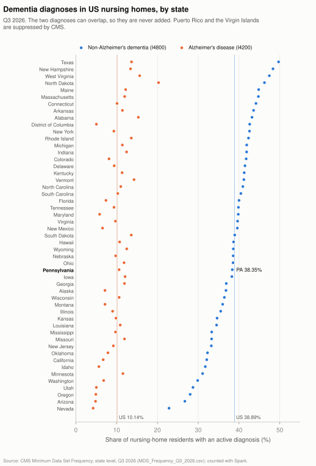

# How big the problem is

How many people live with dementia, how many people care for them, and how many US nursing-home residents have a
dementia diagnosis, with the source sentence behind every published figure. Part of the
[evidence summary](README.md).

> [!NOTE]
> Generated by [`research/notes/evidence_notes.py`](../../research/notes/evidence_notes.py) from the files in [`research/derived/`](../../research/derived/). Edit the script, not this page.

**How the figures were checked:**
- **Published figures:** an AI agent fetched each source and recorded the exact sentence behind the figure. A script
  then fetched the source again and matched that sentence word for word (✓ below).
- **Nursing-home figures:** our own Spark count over the federal Minimum Data Set file, reconciled with the file's
  national row. The [research at scale](research-at-scale.md) page and the [pipeline map](pipeline.md) show how.

## Three numbers

1. **7.4 million** Americans 65 and older live with Alzheimer's dementia in 2026. Worldwide, **57 million** people were
   living with dementia in 2021. WHO's fact sheet says people with dementia "may not be able to recognize family members or friends".
2. **12.7 million** family and other unpaid caregivers gave **19.6 billion hours** of care in 2025. Pennsylvania alone
   has 472,000.
3. **477,804 US nursing-home residents (38.89%)** had an active non-Alzheimer's dementia diagnosis in
   Q3 2026, and **124,553 (10.14%)** had Alzheimer's disease.
   - A resident can have both, so between 39% and 49% had
     either.
   - That bracket agrees with NCHS's 41.1% (2022) and the Alzheimer's Association's 46%.
   - Pennsylvania: 38.35% and 10.61%.

## Published figures, with the sentence each comes from

| Figure | Claim | Exact sentence | Source | Script check |
|---|---|---|---|---|
| 7.4 million | The Alzheimer's Association estimates that 7.4 million Americans aged 65 and older have clinical Alzheimer's dementia in 2026. | “An estimated 7.4 million Americans age 65 and older are living with clinical Alzheimer’s dementia in 2026.” | [p.27 (printed page number; PDF page 29 of 146), Prevalence section, 'Prevalence of Clinical Alzheimer’s Dementia and Other Dementias in the United States'](https://www.alz.org/getmedia/ef8f48f9-ad36-48ea-87f9-b74034635c1e/alzheimers-facts-and-figures.pdf), 2026 Alzheimer’s Disease Facts and Figures (printed citation: Alzheimers Dement 2026;22, https://doi.org/10.1002/alz.71345); PDF metadata created 2026-04-14, modified 2026-07-01; fetched 2026-10-25 | ✓ |
| 12.7 million caregivers; 19.6 billion hours | In 2025, 12.7 million family and other unpaid caregivers gave an estimated 19.6 billion hours of unpaid help to people with Alzheimer's or other dementias in the U.S. | “In 2025, the 12.7 million family and other unpaid caregivers of people living with Alzheimer’s or other dementias provided an estimated 19.6 billion hours of unpaid help.” | [p.52 (PDF page 54), Caregiving section, 'Hours of Unpaid Care and Economic Value of Caregiving'](https://www.alz.org/getmedia/ef8f48f9-ad36-48ea-87f9-b74034635c1e/alzheimers-facts-and-figures.pdf), 2026 Alzheimer’s Disease Facts and Figures (printed citation: Alzheimers Dement 2026;22, https://doi.org/10.1002/alz.71345); PDF metadata created 2026-04-14, modified 2026-07-01; fetched 2026-10-25 | ✓ |
| 1,543 hours (nearly 30 hours per week) | That works out to 1,543 hours of care per caregiver per year, or nearly 30 hours a week. | “This number represents an average of nearly 30 hours of care per caregiver per week, or 1,543 hours of care per caregiver per year.” | [p.52 (PDF page 54), the sentence right after the 19.6 billion hours sentence](https://www.alz.org/getmedia/ef8f48f9-ad36-48ea-87f9-b74034635c1e/alzheimers-facts-and-figures.pdf), 2026 Alzheimer’s Disease Facts and Figures (printed citation: Alzheimers Dement 2026;22, https://doi.org/10.1002/alz.71345); PDF metadata created 2026-04-14, modified 2026-07-01; fetched 2026-10-25 | ✓ |
| 472 (thousands of caregivers); 835 (millions of hours); 17,213 (millions of dollars) | In Pennsylvania in 2025, an estimated 472,000 unpaid caregivers of people with Alzheimer's or other dementias gave 835 million hours of care, valued at about $17.2 billion. | “Pennsylvania 472 835 17,213” | [p.51 (PDF page 53), Table 10](https://www.alz.org/getmedia/ef8f48f9-ad36-48ea-87f9-b74034635c1e/alzheimers-facts-and-figures.pdf), 2026 Alzheimer’s Disease Facts and Figures (printed citation: Alzheimers Dement 2026;22, https://doi.org/10.1002/alz.71345); PDF metadata created 2026-04-14, modified 2026-07-01; fetched 2026-10-25 | ✓ |
| 57 million (2021); over 60%; nearly 10 million new cases a year | WHO says 57 million people worldwide were living with dementia in 2021, over 60% of them in low- and middle-income countries, and there are nearly 10 million new cases each year. | “In 2021, 57 million people were living with dementia worldwide, over 60% of whom live in low-and middle-income countries. Every year, there are nearly 10 million new cases.” | [Key facts, first bullet](https://www.who.int/news-room/fact-sheets/detail/dementia), Fact sheet dated 3 July 2026; fetched 2026-10-25 | ✓ |
| none (qualitative statement) | WHO lists being unable to recognize family members or friends among the changes that can come as dementia progresses. | “People with dementia may not be able to recognize family members or friends, develop difficulties moving around, lose control over their bladder and bowels, have trouble eating and drinking and experience behaviour changes such as aggression that are distressing to the person with dementia as well as those around them.” | [Signs and symptoms section](https://www.who.int/news-room/fact-sheets/detail/dementia), Fact sheet dated 3 July 2026; fetched 2026-10-25 | ✓ |
| 41.1% (2022) | NCHS reports that 41.1% of U.S. nursing home residents were diagnosed with Alzheimer disease or other dementias in 2022. | “Percent of nursing home residents: 41.1% (2022)” | [List 'Percent of long-term care services users diagnosed with Alzheimer disease or other dementias' (Data are for the U.S.)](https://www.cdc.gov/nchs/fastats/alzheimers.htm), Last Reviewed: February 18, 2026; data year 2022; fetched 2026-10-25 | ✓ |
| 46% | The Alzheimer's Association reports that 46% of U.S. nursing home residents have Alzheimer's or other dementias. | “Overall, 46% of nursing home residents have Alzheimer’s or other dementias” | [p.83 (PDF page 85), Use and Costs of Health Care, Long-Term Care and Hospice section, 'Use of Long-Term Care Services by Setting', 'Nursing home care' bullet](https://www.alz.org/getmedia/ef8f48f9-ad36-48ea-87f9-b74034635c1e/alzheimers-facts-and-figures.pdf), 2026 Alzheimer’s Disease Facts and Figures (printed citation: Alzheimers Dement 2026;22, https://doi.org/10.1002/alz.71345); PDF metadata created 2026-04-14, modified 2026-07-01; fetched 2026-10-25 | ✓ |
| 58% (long-stay); 36% (short-stay) | Among long-stay nursing home patients (100 days or longer), 58% have Alzheimer's or other dementias, compared with 36% of short-stay patients. | “While 36% of short-stay (less than 100 days) patients have Alzheimer’s or other dementias, 58% of long-stay (100 days or longer) patients have these conditions.” | [pp.83-84 (PDF pages 85-86); the sentence starts on p.83 and ends at the top of p.84](https://www.alz.org/getmedia/ef8f48f9-ad36-48ea-87f9-b74034635c1e/alzheimers-facts-and-figures.pdf), 2026 Alzheimer’s Disease Facts and Figures (printed citation: Alzheimers Dement 2026;22, https://doi.org/10.1002/alz.71345); PDF metadata created 2026-04-14, modified 2026-07-01; fetched 2026-10-25 | ✓ |
| 70 per cent | Alzheimer's Society estimates that 70% of people in care homes in England have dementia or severe memory problems. | “It is estimated that 70 per cent of people in care homes in England have dementia or severe memory problems.” | [Page 'Facts for the media about dementia', section 'How many people in the UK have dementia?'](https://www.alzheimers.org.uk/what-we-do/news-and-media/facts-media), No date shown on the page; page metadata gives datePublished 03 June 2021 and dateModified 24 September 2026; fetched 2026-10-25 | ✓ |
| 25.4% (N = 55); transient misidentifications of familiar persons N = 34; of 217 outpatients | In a retrospective review of the records of 217 outpatients with Alzheimer's disease, 25.4% (55) had disturbances of person identification, most often transient misidentifications of familiar people (34). | “These disturbances occurred in 25.4% (N = 55) and included transient misidentifications of familiar persons (N = 34), the Capgras syndrome (N = 11), misidentification of themselves in mirrors (N = 5), prosopagnosia (N = 3), misidentification of unfamiliar persons as familiar (N = 1), and misidentification of another person as oneself (N = 1).” | [Abstract](https://www.ebi.ac.uk/europepmc/webservices/rest/search?query=EXT_ID:1737981%20AND%20SRC:MED&format=json&resultType=core), The Journal of nervous and mental disease 180(2):94-96, 1992 (Europe PMC first publication date 1992-02-01); abstract fetched 2026-10-25 | ✓ |
| 15.8% | Based on interviews with patients and their caregivers, misidentification syndromes were found in 15.8% of 392 people with probable Alzheimer's disease. | “On the basis of a semistructured interview with both patients and their reliable caregivers, MIS was identified in 15.8% of cases with AD, 16.6% of patients with DLB, and in 8.3% of individuals with semantic dementia.” | [Abstract](https://www.ebi.ac.uk/europepmc/webservices/rest/search?query=EXT_ID:18525289%20AND%20SRC:MED&format=json&resultType=core), Alzheimer disease and associated disorders 22(2):163-169, 2008 (Europe PMC first publication date 2008-04-01); abstract fetched 2026-10-25 | ✓ |
| 6%; 1,977 patients pooled | A meta-analysis of 8 studies pooling 1,977 people with Alzheimer's disease put the prevalence of Capgras syndrome at 6%. | “Overall, a total of 1,977 patients with Alzheimer's disease were analyzed, and the prevalence of Capgras syndrome in this group was 6% (CI: 95% I² 54% 4.0-8.0).” | [Abstract, Results](https://www.ebi.ac.uk/europepmc/webservices/rest/search?query=EXT_ID:31844501%20AND%20SRC:MED&format=json&resultType=core), Dementia & neuropsychologia 13(4):463-468, 2019 (Europe PMC first publication date 2019-10-01); abstract fetched 2026-10-25 | ✓ |

**Notes on these figures:**
- **Not independent:** NCHS's 41.1% and the Alzheimer's Association's 46% both draw on the NCHS overview of long-term
  care, so cite them as two figures, not as two sources agreeing.
- **Clinic samples:** the misidentification rates (25.4%, 15.8%, Capgras 6%) come from clinic samples of people already
  diagnosed, not from the population.
- **Rounding:** the report prints 1,543 hours per caregiver. Dividing the unrounded totals in its endnotes (19.608
  billion hours ÷ 12.734 million caregivers) gives about 1,540. Cite the printed figure.

## Nursing homes, by state (our own Spark count)

- **Data:** CMS Minimum Data Set Frequency, state level, Q3 2026: 133,920 rows, public, with no login. We use items
  I4200 (Alzheimer's disease) and I4800 (non-Alzheimer's dementia), `Yes` responses only.
- **No double count:** the file includes a `National Total` row among the states. Spark job 6 checks that the states add
  up to it, and they do, within 1 resident.
- **Suppressed:** CMS suppresses the figures for Puerto Rico and the Virgin Islands, shown as `*` in its file. They are
  kept as missing, not dropped.
- **Range:** from Nevada (22.85%) to Texas
  (49.7%) for non-Alzheimer's dementia. Pennsylvania ranks 31 of 51.
