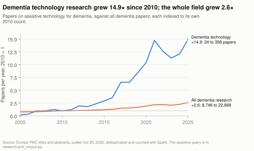
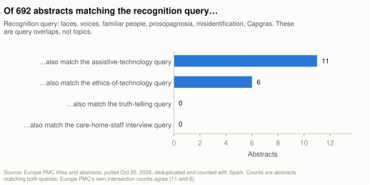
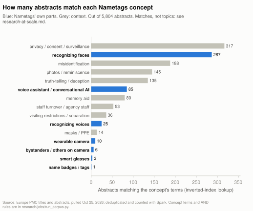

# Research at scale

A Spark analysis of 6,816 dementia papers from Europe PMC, pulled 2026-10-25 00:51 EDT: how fast the
research around Nametags is growing, where it leaves gaps, and what 20 closely read papers say. Part of the
[evidence summary](README.md). The study is framed with the course CSCI 436 (Big Data Management and Analytics), and
the [pipeline map](pipeline.md) shows how the data moved from collection to these pages.

> [!NOTE]
> Generated by [`research/notes/research_note.py`](../../research/notes/research_note.py) from the files in [`research/derived/`](../../research/derived/). Edit the script, not this page.

## The short version

- **The field around Nametags is growing fast.** Papers on assistive technology for dementia went from 24 in 2010
  to 358 in 2025 (×14.9). All dementia papers grew ×2.6 over the same years.
- **What Nametags does sits in a gap between queries.** Of 692 abstracts matching the
  recognition query (faces, voices, misidentification), 11 also match the
  assistive-technology query, 6 the ethics-of-technology query, and
  0 the care-home-staff interview query.
  - **These are query overlaps, not topics.** The 6 ethics matches include a psilocybin
    review and an MRI de-identification tool. Only one of those 6, McCarron et al. 2019, is
    about technology that recognizes people. The 11 assistive overlaps include more prior
    art, such as Fardoun et al. 2017.
  - **What holds:** research on the problem and research on the tools barely meet.
- **Its newest parts barely show up.** Out of 5,804 abstracts, these match each concept's terms:
  - smart glasses: 3 (one of them is about audio glasses);
  - wearable cameras: 10;
  - privacy with cameras and other people: 6 (none uses the word *bystander*);
  - voice-recognition terms: 25. By title, most of these are about speech technology, such as
    voice-controlled cognitive screeners; only a handful study how people with dementia recognize voices.



## The corpus

Five Europe PMC queries over titles and abstracts, restricted to records with an abstract and with preprints excluded.
The exact query strings are in [`pull_corpus.py`](../../research/pull_corpus.py) and in [`raw/manifest.json`](../../research/raw/manifest.json),
which also records each query's hit count at pull time. The pull checks that it got exactly as many records as each
query's hit count.

| Theme | What the query matches | Europe PMC hits | Kept after veracity checks |
|---|---|---|---|
| Assistive technology | named assistive technologies (smart homes, telecare, memory aids, robots, smart glasses, wearable cameras), or technology words alongside daily-life words | 3,218 | 3,218 |
| Recognizing people | face, facial, voice, speaker and person recognition; familiar or famous faces and voices; prosopagnosia; misidentification; Capgras | 692 | 692 |
| Care-home staff (qualitative) | care or nursing homes, with staff, studied by interview, focus group or thematic analysis | 1,254 | 1,254 |
| Ethics of technology | ethics, privacy, surveillance, consent, autonomy or dignity, alongside AI, monitoring, cameras, sensors, robots, voice assistants | 1,064 | 1,020 |
| Truth-telling and deception | lying, deception, truth-telling, white lies, validation therapy | 1,138 | 132 |

- **Combined and deduplicated:** 6,816 papers. This is exactly the combined query's hit count,
  which job 0 checks.
- **After the veracity filters below:** 5,804 papers.

## Veracity: four problems found in the data and fixed

CSCI 436's fourth V, veracity, asks whether the data can be trusted. Each of these problems was found by checking the
output, not assumed.

1. **APP is a protein.** Europe PMC search ignores case, so the assistive query's word `app` also matched APP, the
   amyloid precursor protein.
   - The query's `memory` matched nearly every Alzheimer's abstract, so mouse-model papers poured in.
   - In the first pull, 3,456 of 7,926 assistive records
     (44%) were lab biology that named no assistive technology.
     Their top words were *amyloid* and *mice*.
   - The fix: `app` now appears only inside phrases like `mobile app`, and the same goes for tablets (pills), sensors
     (biosensors) and `digital` (digital PCR).
   - The theme fell to 3,218 records, of which 39 (about
     1.2%) still carry lab-biology markers.
   - Fixing it changed the headline growth figure from ×7.5 to ×14.9: the biology
     papers had been inflating the 2010 baseline.
2. **`lies` is also a verb.** The truth-telling query includes the words `lie` and `lies`, which mostly match sentences
   like *the novelty lies in…*. The same goes for *lying in bed*.
   - A filter in job 0's map step keeps the truth tag only when real truth-telling language is present.
   - It removed 1,006 tags, keeping 132 of 1,138.
3. **Ethics boilerplate.** 44 ethics records were there only because the abstract says *ethics
   committee approval* or *written informed consent*. The same map-step filter removed them.
4. **The CMS file contains a national row.** The nursing-home file has a `National Total` row among the states, so
   summing all rows double-counts the country.
   - The states reconcile with that row within 1 resident, and job 6 checks it.
   - Puerto Rico and the Virgin Islands are suppressed by CMS, shown as `*`. They're kept as missing, not dropped.

## Growth

| Theme | 2010 | 2015 | 2020 | 2025 | 2025 vs 2010 |
|---|---|---|---|---|---|
| Assistive technology | 24 | 70 | 249 | 358 | ×14.9 |
| Ethics of technology | 6 | 19 | 52 | 163 | ×27.2 |
| Care-home staff (qualitative) | 19 | 45 | 80 | 98 | ×5.2 |
| Recognizing people | 16 | 30 | 30 | 44 | ×2.8 |
| All dementia papers (for scale) | 8,746 | 10,529 | 16,689 | 22,868 | ×2.6 |

The ethics of dementia technology grew fastest, from 6 to 163 papers. By
contrast, research on recognizing people grew only at the field's pace.

## The gap



Papers in both themes. The diagonal is each theme's size after the veracity filters.

|  | Assistive technology | Recognizing people | Care-home staff (qualitative) | Ethics of technology | Truth-telling and deception |
|---|---|---|---|---|---|
| Assistive technology | 3,218 | 11 | 86 | 388 | 10 |
| Recognizing people | 11 | 692 | 0 | 6 | 0 |
| Care-home staff (qualitative) | 86 | 0 | 1,254 | 22 | 5 |
| Ethics of technology | 388 | 6 | 22 | 1,020 | 8 |
| Truth-telling and deception | 10 | 0 | 5 | 8 | 132 |

Europe PMC's own intersection counts agree, and job 5 checks both: recognizing people with assistive technology gives
11 papers, and recognizing people with ethics of technology gives
6.

## How much research touches each Nametags feature



**How the counts work.** These come from boolean retrieval over the inverted index (job 3), as in Lecture 4 of the
course. Words with a second meaning only count next to their context:
- `masks` only with COVID or wearing;
- `visits` only with family and restrictions;
- `turnover` only with staff;
- `surveillance` and `consent` only with cameras or sensors;
- `misidentification` only with delusion, syndrome or familiar people.

The full term lists are in [`jobs/run_corpus.py`](../../research/jobs/run_corpus.py).

**Caveats:**
- **Not recognizing family:** this concept is still noisy. The index matches words anywhere in an abstract, not within
  one sentence, so it is listed below but left out of the chart.
- **Name badges:** the single match is a 1992 study about remembering famous *names*, so effectively nothing studies
  name badges.

| Concept | Papers | Most-cited match |
|---|---|---|
| privacy / consent / surveillance | 317 | Nursing home facility risk factors for infection and hospitalization… (2002) |
| recognizing faces | 287 | Development of cognitive instruments for use in clinical trials of antidementia… (1997) |
| misidentification | 188 | The course of psychopathologic features in mild to moderate Alzheimer disease. (1997) |
| photos / reminiscence | 145 | Systematic review of systematic reviews of non-pharmacological interventions to… (2017) |
| truth-telling / deception | 135 | Systematic review of systematic reviews of non-pharmacological interventions to… (2017) |
| voice assistant / conversational AI | 85 | ChatGPT vs Google for Queries Related to Dementia and Other Cognitive Decline… (2023) |
| memory aid | 80 | Memory complaints in older adults. Fact or fiction? (1991) |
| not recognizing family | 53 | Semantic dementia and fluent primary progressive aphasia: two sides of the same… (2006) |
| staff turnover / agency staff | 53 | Nursing home facility risk factors for infection and hospitalization… (2002) |
| visiting restrictions / separation | 36 | Experiences and Needs of Caregivers of Persons With Dementia in India During… (2020) |
| recognizing voices | 25 | Voice processing in dementia: a neuropsychological and neuroanatomical analysis. (2011) |
| masks / PPE | 14 | The Impact of Social Distancing Due to the COVID-19 Pandemic on People with… (2022) |
| wearable camera | 10 | The use of a wearable camera improves autobiographical memory in patients with… (2015) |
| bystanders / others on camera | 6 | Virtual Data Collection Strategies in Research on Alzheimer's Disease and… (2025) |
| smart glasses | 3 | A digitally supported multimodal lifestyle program to promote brain health… (2024) |
| name badges / tags | 1 | When Greta Garbo is easier to remember than Stefan Edberg: influences of prior… (1992) |

## What each theme talks about

Word count, as in the course's Hadoop Lab 1: each word or word pair is counted once per paper, after removing English
stopwords and the words nearly every abstract here shares (dementia, patients, study and the like).

| Theme | Top 10 terms |
|---|---|
| Assistive technology | care, technology, support, health, caregivers, living, cognitive, quality, life, intervention |
| Recognizing people | cognitive, face, memory, recognition, ad, impairment, clinical, brain, early, performance |
| Care-home staff (qualitative) | care, staff, interviews, qualitative, residents, home, homes, nursing, conducted, living |
| Ethics of technology | care, ethical, technology, clinical, health, cognitive, support, potential, technologies, monitoring |
| Truth-telling and deception | care, therapy, validation, validation therapy, ethical, truth, cognitive, deception, lying, interventions |

## Rising and falling terms, 2011–18 against 2019–25

The counts are papers per era: 1,313 papers in 2011–18 and
3,236 in 2019–25. Publishing boilerplate (registered-report identifiers, COREQ and CONSORT
phrases) is left out.

- **Rising:** covid (0 → 324); covid pandemic (0 → 238); pandemic (1 → 288); deep learning (0 → 56); plwd (1 → 99); intelligence ai (1 → 86); underscores (0 → 39); digital literacy (0 → 36).
- **Falling:** probable ad (12 → 3); norwegian nursing (12 → 3); ventral (15 → 4); famous face (12 → 4); neuroanatomical (12 → 4); thesis (11 → 4); theories (14 → 6); attempts (16 → 7); style (18 → 8); die (18 → 8); functional magnetic (20 → 9); fusiform (15 → 7); memory deficits (15 → 7); face processing (15 → 7); fmri (22 → 11).

Two shifts stand out: COVID became a research topic in its own right, and AI and deep learning arrived. Meanwhile, the
recognition theme's older neuroimaging vocabulary (fusiform, famous faces, fMRI) is fading.

## The reading list

**Selection rule:** tf-idf top 15 after replacing ranks 1, 9, 14 and 15 (reasons in 'dropped') with ranks 16, 21, 26 and 29, plus five papers picked for the study's open tensions.

**Dropped:**
- rank 1: a diet assistant for caregivers: voice-assistant term, off-topic for recognizing people
- rank 9: generic survey of assistive-technology provision in the UK
- rank 14: generic survey of installed assistive technology
- rank 15: same project as rank 26 (conference abstract vs journal paper); the journal paper is kept

| # | Year | Title | Why | Read from |
|---|---|---|---|---|
| 1 | 2023 | Can Technology-Based Social Memory Aids Improve Social Engagement? Perceptions of a Novel… | tf-idf rank 2 | abstract |
| 2 | 2003 | Misidentification in patients with dementia. | tf-idf rank 3 | abstract |
| 3 | 2017 | Famous faces and voices: Differential profiles in early right and left semantic dementia… | tf-idf rank 4 | abstract |
| 4 | 2015 | Recognition of personally familiar faces and functional connectivity in Alzheimer's… | tf-idf rank 5 | abstract |
| 5 | 2019 | Informal carers' experience of assistive technology use in dementia care at home: a… | tf-idf rank 6 | full text |
| 6 | 2026 | Uses of assistive technology incorporating smart camera features in the rehabilitation of… | tf-idf rank 7 | abstract |
| 7 | 2017 | Problems of Face Recognition in Patients with Behavioral Variant Frontotemporal Dementia. | tf-idf rank 8 | full text |
| 8 | 2003 | An electronic memory aid to support prospective memory in patients in the early stages of… | tf-idf rank 10 | abstract |
| 9 | 2015 | The use of a wearable camera improves autobiographical memory in patients with… | tf-idf rank 11 | abstract |
| 10 | 2022 | Paranoid and misidentification subtypes of psychosis in dementia. | tf-idf rank 12 | abstract |
| 11 | 2016 | Wearable Technology to Garner the Perspective of Dementia Family Caregivers. | tf-idf rank 13 | abstract |
| 12 | 2023 | Design, development, and use of conversational agents in rehabilitation for adults with… | tf-idf rank 16 | abstract |
| 13 | 2015 | Usability of a Wearable Camera System for Dementia Family Caregivers. | tf-idf rank 21 | abstract |
| 14 | 2019 | A Web-Based Mobile App With a Smartwatch to Support Social Engagement in Persons With… | tf-idf rank 26 | full text |
| 15 | 2017 | Recognition of familiar people with a mobile cloud architecture for Alzheimer patients. | tf-idf rank 29 | abstract |
| 16 | 2011 | Do people with dementia find lies and deception in dementia care acceptable? | targeted: truth-telling / Nova disclosure | abstract |
| 17 | 2021 | Chatbots to Support People With Dementia and Their Caregivers: Systematic Review of… | targeted: Nova / conversational AI | full text |
| 18 | 2021 | Usability and Acceptance of the Embodied Conversational Agent Anne by People With… | targeted: Nova / conversational AI | full text |
| 19 | 2011 | Ethics of using assistive technology in the care for community-dwelling elderly people… | targeted: ethics of assistive technology | abstract |
| 20 | 2023 | Privacy-protecting behaviours of risk detection in people with dementia using videos. | targeted: cameras and bystander privacy | full text |

## What the 20 papers say (verified)

Four AI agents read the papers, using the open full text where there is one and the abstract otherwise. Four other
agents then tried to refute each entry: 4 confirmed, 16 corrected. Two checks back that up:
- every supporting sentence below was matched word for word in its source by script;
- every DOI was checked against Crossref for title, first author and year.

The entries refer to the study's open tensions by number:

1. **Truthful naming versus care practice.** Nametags names people truthfully, while care staff often go along with a resident who takes one person for another.
2. **Nova and AI disclosure.** Nova is told never to mention being an AI unless asked, which the research on deception, AI companions and disclosure to people with dementia has to be weighed against.
3. **A camera and microphone in shared spaces.** The glasses see and hear other residents, staff and visitors, so bystander privacy and consent come into play.
4. **Recognition failures that matter in care homes.** Masks, long separations, changes in appearance, staff turnover and look-alike relatives.
5. **Where photos and audio are processed.** On a laptop the API runs locally; deployed to a server with [DEPLOY.md](../../DEPLOY.md), photos and audio leave the wearer's own machine.

### Can Technology-Based Social Memory Aids Improve Social Engagement? Perceptions of a Novel Memory Aid for Persons With Memory Concerns (2023)

- **Relevance to Nametags:** high. Read from the abstract.
- **What it shows:** Twenty care dyads (persons with memory concerns and family caregivers) were presented a wearable technology-based social memory aid. Overall, participants anticipated that it could reduce socializing-related stress, now and in the future, for both members of the dyad. The abstract also reports that some features, such as visitors needing the app, could limit its utility, but it does not say whether participants or the authors raised this. Nametags identifies people by face and voice, so visitors need no app. It has the analogous limit that it can name only the people a family member has enrolled.
- **Method and sample:** qualitative semi-structured interviews over Zoom (June–August 2020) after the aid was presented, 20 dyads of persons with memory concerns and family caregivers, thematic analysis; country not stated in the abstract
- **Limitation:** Participants were shown the aid rather than using it, so the reduced stress is anticipated, not measured, and they are described as persons with memory concerns, not specifically people with dementia.
- **Supporting sentence:** “However, certain features of the memory aid (e.g., visitors must have the app), could limit utility, and participants provided recommendations to enhance the tool.”
- **Checks:** the sentence was matched word for word in its source, by script;
  [doi:10.1177/07334648221134869](https://doi.org/10.1177/07334648221134869) matches Crossref on title, first author and year. The refuting agent's verdict: corrected.

### Usability and Acceptance of the Embodied Conversational Agent Anne by People With Dementia and Their Caregivers: Exploratory Study in Home Environment Settings (2021)

- **Relevance to Nametags:** high. Read from the full text.
- **What it shows:** In a 4-week home trial of the tablet agent Anne, some people with early dementia said speech-recognition errors (Anne sometimes answered a different question) hurt their intention to use it, its usefulness and their trust, and their ratings of usefulness and trust fell over the 4 weeks. Nova takes spoken questions, so a misheard name in a question like "Nova, who is David?" is the failure this study points to; the study itself did not test questions about people.
- **Method and sample:** mixed-methods 4-week home field trial (acceptance and usability questionnaires, telemetry, short open questions), 20 people with early dementia (MMSE 24-27) and 14 family caregivers, Ancona, Italy
- **Limitation:** A single small 4-week trial in one Italian city, limited to early-stage people living independently who had training, a manual and a support line, so it says little about later-stage or care-home users.
- **Supporting sentence:** “Some of them clearly discussed how technical problems related to speech recognition had a negative impact on intention to use, adaptiveness, usefulness, and trust.”
- **Checks:** the sentence was matched word for word in its source, by script;
  [doi:10.2196/25891](https://doi.org/10.2196/25891) matches Crossref on title, first author and year. The refuting agent's verdict: confirmed.

### A Web-Based Mobile App With a Smartwatch to Support Social Engagement in Persons With Memory Loss: Pilot Randomized Controlled Trial (2019)

- **Relevance to Nametags:** high. Read from the full text.
- **What it shows:** In a 6-month pilot trial with 48 people with memory loss, prior art very close to Nametags (a phone that recognized enrolled faces and showed the person's name and relationship on a smartwatch) showed no significant effect on quality of social interaction or quality of life, in a trial its authors say is small and could be considered underpowered, and most participants interviewed did not find it useful. Their reasons bear on Nametags' enrollment (by a family member, or since commit 0245eb3 by visitors themselves through /visitor) and look-alike-relative risk: enrolling was time-consuming, cumbersome and awkward, so many said they only felt comfortable asking people they knew well to enroll, often people the person with memory loss already remembered; several participants reported that it only worked in certain lighting; one caregiver said that by the time it recognized a face her husband had already asked her who the person was; and another said it could not tell her son from her son-in-law, who were both bald with beards but otherwise had little physical resemblance.
- **Method and sample:** pilot randomized controlled trial, 48 people with memory loss (20 app, 28 usual care), 35 of them with a caregiver who completed the surveys and 13 with no caregiver available, 6 months, plus 13 phone interviews with intervention-group participants; Minnesota, USA
- **Limitation:** Small and underpowered (not planned as a pilot in advance), outcomes mostly reported by caregivers, no record of how much the app was used, and a sample that included mild cognitive impairment and self-reported memory concerns.
- **Supporting sentence:** “The absence of empirical intervention effects is supported by the qualitative analysis, which revealed that the majority of participants did not find the SSA useful.”
- **Checks:** the sentence was matched word for word in its source, by script;
  [doi:10.2196/13378](https://doi.org/10.2196/13378) matches Crossref on title, first author and year. The refuting agent's verdict: corrected.

### Recognition of familiar people with a mobile cloud architecture for Alzheimer patients (2017)

- **Relevance to Nametags:** high. Read from the abstract.
- **What it shows:** Earlier prior art for Nametags: photos taken with a smartwatch went to face recognition in the cloud and details about the recognized person came back to the watch; the authors report correct results (no figures in the abstract) but usability problems for patients with dementia in reading the small screen and taking a proper photo. Nametags' spoken announcement and hands-free glasses camera skip both steps by design (not tested here), but Nametags still puts text in front of the wearer: the context card and, since commit 0245eb3, the glasses HUD with face tags and live captions of the conversation, so the paper's reading difficulty bears on those (not tested here). The cloud design is the same choice as the DEPLOY.md server, whose privacy this abstract does not discuss.
- **Method and sample:** system architecture and prototype tested in a real-life scenario; sample size not given in the abstract
- **Limitation:** Only the abstract was readable, and it gives no accuracy figures, sample size or test conditions, so the claim of correct results cannot be weighed.
- **Supporting sentence:** “However, when being targeted to patients with dementia some usability problems appeared, such as difficulties to read information in a small screen or take a proper photo.”
- **Checks:** the sentence was matched word for word in its source, by script;
  [doi:10.3109/09638288.2015.1025992](https://doi.org/10.3109/09638288.2015.1025992) matches Crossref on title, first author and year. The refuting agent's verdict: corrected.

### Do people with dementia find lies and deception in dementia care acceptable? (2011)

- **Relevance to Nametags:** high. Read from the abstract.
- **What it shows:** Interviewed directly, people with dementia judged carers' lies acceptable if told in their best interest, a judgement shaped by whether they were aware of the lie and by why the carer lied. That bears on tension 1 (the announcement names people truthfully) and tension 2 (Nova does not say it is an AI unless asked), but the study concerns lies told by human carers, not by a device.
- **Method and sample:** qualitative Grounded Theory study with a two-phased design: a series of one-to-one interviews with people with dementia, then re-interviews of the same participants to develop the emerging theory; sample size, dementia stage and country not given in the abstract
- **Limitation:** Only the abstract was available, so the sample size, the participants' dementia stage and the kinds of lies discussed are unknown, and the abstract does not mention technology or AI.
- **Supporting sentence:** “This best interest decision was complex, and influenced by factors such as the person with dementia's awareness of the lie, and the carer's motivation for lying.”
- **Checks:** the sentence was matched word for word in its source, by script;
  [doi:10.1080/13607863.2011.569489](https://doi.org/10.1080/13607863.2011.569489) matches Crossref on title, first author and year. The refuting agent's verdict: corrected.

### Uses of assistive technology incorporating smart camera features in the rehabilitation of people living with disabilities: a scoping review (2026)

- **Relevance to Nametags:** medium. Read from the abstract.
- **What it shows:** Of 25 studies of assistive technology with smart camera features (13 involved smart glasses, 23 served visual impairment), one focused on facial recognition for people with Alzheimer's disease, and the abstract does not say what device that study used or what it found. So within this review's scope, the evidence on face recognition for people with Alzheimer's disease is thin: one focused study. The review also reports technical limitations, usability issues and high financial costs with various devices.
- **Method and sample:** scoping review (Joanna Briggs Institute method) of 25 studies of assistive technology with at least one smart camera feature, used in rehabilitation in any setting; participants of any age with any disability were eligible, and 23 of the 25 studies were on visual impairment
- **Limitation:** Read from the abstract only, which does not name the one Alzheimer's face-recognition study or report its results, and the evidence is mostly about visual impairment, not dementia.
- **Supporting sentence:** “One study focused on facial recognition for people with Alzheimer's disease and one on reading for children with dyslexia.”
- **Checks:** the sentence was matched word for word in its source, by script;
  [doi:10.1080/17483107.2026.2678548](https://doi.org/10.1080/17483107.2026.2678548) matches Crossref on title, first author and year. The refuting agent's verdict: corrected.

### Design, development, and use of conversational agents in rehabilitation for adults with brain-related neurological conditions: a scoping review (2023)

- **Relevance to Nametags:** medium. Read from the abstract.
- **What it shows:** A scoping review found 11 papers on conversational agents in rehabilitation for adults with brain conditions (7 aimed at people with dementia alone or in mixed groups), all at an early stage with samples of 1 to 33, no effectiveness testing and safety considered in only two, so this review offers no evidence that a voice assistant like Nova helps people with dementia; it cannot rule out evidence outside its scope (English-language rehabilitation studies, in a review published in February 2023). None of the purposes the papers reported was identifying people, which is Nova's job, and the authors ask future studies to clearly define safety issues and requirements for clinician oversight; Nametags gives Nova behavior rules (never guess or invent a fact, never bring up illness or diagnoses) but says nothing about clinician oversight.
- **Method and sample:** scoping review of 11 papers (7 prototypes); MEDLINE, Scopus, ProQuest, Web of Science and gray literature, no date limit, English only
- **Limitation:** Only the abstract was read, and the review covers few, small, heterogeneous studies with no effectiveness or health outcomes, so it shows a gap rather than evidence for or against Nova.
- **Supporting sentence:** “No studies undertook effectiveness testing.”
- **Checks:** the sentence was matched word for word in its source, by script;
  [doi:10.11124/jbies-22-00025](https://doi.org/10.11124/jbies-22-00025) matches Crossref on title, first author and year. The refuting agent's verdict: corrected.

### Privacy-protecting behaviours of risk detection in people with dementia using videos (2023)

- **Relevance to Nametags:** medium. Read from the full text.
- **What it shows:** In a Toronto dementia unit whose common-area camera feed also caught other residents, staff and visitors, the study turned audio off, kept cameras out of bedrooms and washrooms, and had staff and participants' substitute decision-makers give written consent. Replacing people with skeletons or segmentation masks while keeping the background kept risk detection about as good as raw video (best AUC(ROC) 0.812 for skeletons and 0.823 for masks, vs 0.822 for raw video); removing the background as well lowered it to 0.640 to 0.765. That is a concrete precedent for tension 3, set against glasses that go wherever the wearer goes, transcribe what everyone says and exist to identify people, the very information this study removed.
- **Method and sample:** technical study of privacy-protecting video anomaly detection (skeletons or segmentation masks fed to convolutional autoencoders); about 21 h training and 9 h test video from one participant and one camera, out of a 2-year, 17-participant study in a specialized dementia unit, Toronto, Canada
- **Limitation:** It measures detection accuracy for one participant on one fixed camera, not how residents, staff or visitors felt about being filmed, and it uses fixed surveillance cameras, not a worn one.
- **Supporting sentence:** “Due to privacy concerns, the cameras were not installed in the bedrooms and washrooms of participating residents, and the audio was turned off.”
- **Checks:** the sentence was matched word for word in its source, by script;
  [doi:10.1186/s12938-023-01065-3](https://doi.org/10.1186/s12938-023-01065-3) matches Crossref on title, first author and year. The refuting agent's verdict: corrected.

### Chatbots to Support People With Dementia and Their Caregivers: Systematic Review of Functions and Quality (2021)

- **Relevance to Nametags:** medium. Read from the full text.
- **What it shows:** In this review of commercial dementia chatbots, only 6 of the 505 found met the criteria (5 were Alexa voice skills), and no peer-reviewed research was identified for any of them (after the review, the CogniCare developers published a peer-reviewed article on developing their apps that reported no outcome findings for users). The researchers had trouble getting some voice skills started, because Alexa's voice recognition was not always flexible with their pronunciation or a skill needed a specific command to start, and most apps' limited programmed content created challenges whenever the evaluators did not use specific commands, although 5 of the 6 were easy to use once started; the authors warn this may create barriers for people with cognitive impairment. For Nova that is a caution about depending on a spoken wake word ("Nova", "Hey Nova"), not evidence about Nova itself: no person with dementia tested the apps in this review, and their dialog was pre-programmed and narrow, unlike Nova's language model.
- **Method and sample:** systematic review of commercial chatbot apps (Google Play, Apple App Store, Alexa Skills, web), Dec 2019 to Apr 2020; 505 found, 6 included; rated by the research team, not by end users
- **Limitation:** The apps were judged by the researchers against a chatbot-quality framework, with no people with dementia or caregivers testing them, and their pre-programmed 2020 dialog says little about a language-model assistant like Nova.
- **Supporting sentence:** “For instance, most apps had limitations in their programmed content, which created challenges when evaluators did not use specific commands.”
- **Checks:** the sentence was matched word for word in its source, by script;
  [doi:10.2196/25006](https://doi.org/10.2196/25006) matches Crossref on title, first author and year. The refuting agent's verdict: corrected.

### Informal carers' experience of assistive technology use in dementia care at home: a systematic review (2019)

- **Relevance to Nametags:** medium. Read from the full text.
- **What it shows:** In the review's thematic synthesis of carers' experiences, carers' continuous engagement and willingness to help the person with dementia use assistive technology was key to its use in most of the studies. The authors also conclude that installing AT at home was often wrongly seen as a one-off event rather than an ongoing process. Nametags relies on a family member enrolling every person (photos, voice sample, facts), so it is likely to need re-enrollment as faces, voices and visitors change (tension 4), not a single setup. That is an inference; the review did not test it.
- **Method and sample:** systematic review with narrative synthesis (aggregative qualitative synthesis): 56 publications (30 qualitative, 17 quantitative, 9 mixed methods) reporting on 50 studies from 19 countries, published 2000–2018, with findings from 2016 carers; some included studies also had paid carers or people in long-term care, and the review reports results only for family carers and people with dementia living at home
- **Limitation:** It covers carers at home only (care homes and paid carers were excluded) and English-language studies, and its outcome measures were too varied to pool, so its conclusions are descriptive.
- **Supporting sentence:** “It is also clear from this review that installation of AT at home for use by someone who has dementia was often wrongly seen as a one-off event, rather than an ongoing process for getting the best out of AT.”
- **Checks:** the sentence was matched word for word in its source, by script;
  [doi:10.1186/s12877-019-1169-0](https://doi.org/10.1186/s12877-019-1169-0) matches Crossref on title, first author and year. The refuting agent's verdict: corrected.

### Famous faces and voices: Differential profiles in early right and left semantic dementia and in Alzheimer's disease (2017)

- **Relevance to Nametags:** medium. Read from the abstract.
- **What it shows:** The study screened out perceptual problems: it kept only patients without visual or auditory perceptual impairment, from a pool the abstract describes as *early SD and AD*. Alzheimer's disease patients were significantly impaired at naming famous faces and voices but showed preserved recognition, while semantic dementia patients were profoundly impaired at both naming and recognition. That fits the announcement's premise (give the name to someone who still knows the person) better for AD than for semantic dementia (inference). The stimuli were famous people, not family.
- **Method and sample:** comparative neuropsychological study using an experimental battery of famous face and voice recognition and naming: 13 semantic dementia patients (8 with mainly right and 5 with mainly left temporal atrophy) and 25 patients the abstract labels *CE* (apparently the AD group), selected from a pool described as *early SD and AD* because they showed no visual or auditory perceptual impairment; FDG-PET correlation in 12 SD patients; country not stated in the abstract
- **Limitation:** Small groups, drawn from a pool the abstract describes as *early SD and AD*, were tested on famous rather than personally familiar faces and voices, so the result may not carry over to recognizing family members or to later dementia.
- **Supporting sentence:** “Results showed a differential performance profile in the two diseases, because AD patients were significantly impaired in the naming tests, but showed preserved recognition, whereas SD patients were profoundly impaired both in naming and in recognition of famous faces and voices.”
- **Checks:** the sentence was matched word for word in its source, by script;
  [doi:10.1016/j.neuropsychologia.2016.11.020](https://doi.org/10.1016/j.neuropsychologia.2016.11.020) matches Crossref on title, first author and year. The refuting agent's verdict: corrected.

### Problems of Face Recognition in Patients with Behavioral Variant Frontotemporal Dementia (2017)

- **Relevance to Nametags:** medium. Read from the full text.
- **What it shows:** Among 46 people with behavioral-variant frontotemporal dementia (FTD), 24 showed defective face recognition and 12 had a defect recognizing the face of a spouse or relative they had lived with for at least a year. The authors also state, without testing it or citing a source, that a person with Alzheimer's can still recognize someone when that person is named or speaks to them, but a person with FTD cannot by any route; if that holds, the spoken announcement ("That's David, your grandson") fits an Alzheimer's wearer better than an FTD wearer.
- **Method and sample:** clinical study using non-validated picture tests and a mirror test, 46 patients with behavioral-variant FTD (15 women, 31 men, MMSE above 20), India
- **Limitation:** The face tests were not validated (one famous face and some emotion pictures), there was no formal control group, and some percentages do not match the paper's own counts (10 of 15 women is reported as 70%).
- **Supporting sentence:** “Prosopagnosia in Alzheimer's disease is of visuospatial nature and hence can recognize the individual when named or spoken to, but in FTD, it is multimodal and hence cannot be recognized by any mode.”
- **Checks:** the sentence was matched word for word in its source, by script;
  [doi:10.4103/ijpsym.ijpsym_90_17](https://doi.org/10.4103/ijpsym.ijpsym_90_17) matches Crossref on title, first author and year. The refuting agent's verdict: confirmed.

### Recognition of personally familiar faces and functional connectivity in Alzheimer's disease (2015)

- **Relevance to Nametags:** medium. Read from the abstract.
- **What it shows:** Recognition of one's own and personally familiar faces from photographs was preserved in mild Alzheimer's disease but affected in moderate AD. So by the moderate stage a wearer may not recognize a familiar visitor at all, not just fail to recall the name (inference). The study measured recognition, not naming, and tested no aid, so it does not show whether the announcement and 'Who is this?' matter less in mild AD.
- **Method and sample:** two behavioral experiments (mild AD, then moderate AD, each against healthy older adults) using photographs of self and familiar faces from different decades of life, with resting-state fMRI in the moderate group; sample sizes not given in the abstract
- **Limitation:** The abstract gives no sample sizes, and recognition was tested on photographs in a lab task rather than on live visitors.
- **Supporting sentence:** “However, in moderate AD, both self and familiar face recognition were affected.”
- **Checks:** the sentence was matched word for word in its source, by script;
  [doi:10.1016/j.cortex.2015.03.013](https://doi.org/10.1016/j.cortex.2015.03.013) matches Crossref on title, first author and year. The refuting agent's verdict: corrected.

### The use of a wearable camera improves autobiographical memory in patients with Alzheimer's disease (2015)

- **Relevance to Nametags:** medium. Read from the abstract.
- **What it shows:** In people with mild-to-moderate Alzheimer's, reviewing images from a small wearable camera brought back more details of personal events than a written diary did (5 of 6 patients over two weeks, 4 of 5 at three months). This is prior art for a worn camera in Alzheimer's, but for recalling events, not recognizing people: Nametags uses its glasses camera only for live recognition and turns a visit into text (a transcript, then facts and a card), not images to review.
- **Method and sample:** within-patient comparison of camera-image review versus a written diary, 6 patients with mild-to-moderate Alzheimer's, 40 events, follow-up at one and three months
- **Limitation:** Only six patients (one dropped out by three months), and the camera recorded significant events that were then reviewed in a structured way, so it says little about everyday continuous wear.
- **Supporting sentence:** “Across 40 events the SenseCam review method resulted in significantly more details of an event being recalled over two weeks than the written diary method in five out of the six patients.”
- **Checks:** the sentence was matched word for word in its source, by script;
  [doi:10.1080/09658211.2014.886703](https://doi.org/10.1080/09658211.2014.886703) matches Crossref on title, first author and year. The refuting agent's verdict: confirmed.

### Usability of a Wearable Camera System for Dementia Family Caregivers (2015)

- **Relevance to Nametags:** medium. Read from the abstract.
- **What it shows:** When family caregivers wore a camera system for 3 to 7 days to record difficult behaviors for health care providers (the abstract does not say where), they judged its benefits worth the invasion of privacy beforehand, their privacy concerns did not change significantly after wear, and they found it easy to learn but cumbersome and obtrusive. That is small, indirect support for a worn camera around a person with dementia: the privacy judgment was the wearers' own, and nothing here tests a person with dementia wearing the camera or other residents and staff as bystanders (tension 3).
- **Method and sample:** usability study, 9 caregiving dyads (persons with dementia mean MMSE 17.33), 3 to 7 days of caregiver wear, 140 hours recorded
- **Limitation:** Nine dyads, a caregiver-worn device and only the abstract read: the privacy result is the wearers' own rating, and the abstract gives no figures for the reactions of the persons with dementia.
- **Supporting sentence:** “Prior to using the system, CGs assessed its benefits to be worth the invasion of privacy; post-wear privacy concerns did not differ significantly.”
- **Checks:** the sentence was matched word for word in its source, by script;
  [doi:10.1260/2040-2295.6.2.213](https://doi.org/10.1260/2040-2295.6.2.213) matches Crossref on title, first author and year. The refuting agent's verdict: corrected.

### Ethics of using assistive technology in the care for community-dwelling elderly people: an overview of the literature (2011)

- **Relevance to Nametags:** medium. Read from the abstract.
- **What it shows:** A review of 46 papers on assistive technology for older people living at home, focused on dementia, found three ethical themes: privacy, autonomy and obtrusiveness in the home; stigma and human contact; and device design (individual approach, affordability, safety). These frame the worn camera-and-microphone glasses in general, but the abstract gives no evidence specific to cameras, face or voice recognition, or voice assistants.
- **Method and sample:** systematic literature review, 46 papers, international literature on assistive technology for community-dwelling older people, focused on dementia
- **Limitation:** Read from the abstract only; it reviews ethical arguments in the literature rather than measured outcomes, and it covers people living at home, not care homes.
- **Supporting sentence:** “The first theme, personal living environment, involves the subthemes privacy, autonomy and obtrusiveness.”
- **Checks:** the sentence was matched word for word in its source, by script;
  [doi:10.1080/13607863.2010.543662](https://doi.org/10.1080/13607863.2010.543662) matches Crossref on title, first author and year. The refuting agent's verdict: confirmed.

### Misidentification in patients with dementia (2003)

- **Relevance to Nametags:** medium. Read from the abstract.
- **What it shows:** In a retrospective study of 116 dementia patients, 35% had misidentification, which the study characterized as misidentification of people, the *phantom boarder*, the *mirror image* or the *TV sign*. Misidentification was closely related to accusatory behavior, although age, sex, cognitive impairment, stage of illness and functional disability confounded that association. The authors conclude that misidentification is a frequent component of dementia, so truthful announcements and Nova answers may contradict what some wearers believe (tension 1; an inference, not tested). The abstract does not give the rate for misidentifying people alone, and its stated aims do not include correcting misidentification.
- **Method and sample:** retrospective study, 116 dementia patients; setting and country not stated in the abstract
- **Limitation:** The abstract reports one 35% figure pooled across four different misidentification types, not the rate for misidentifying people alone, and the link to accusatory behavior was confounded by age, sex, cognitive impairment, stage and functional disability.
- **Supporting sentence:** “35% had misidentification and there was a close relationship between misidentification and accusatory behavior.”
- **Checks:** the sentence was matched word for word in its source, by script;
  [doi:10.1016/s0167-4943(03)00045-1](https://doi.org/10.1016/s0167-4943(03)00045-1) matches Crossref on title, first author and year. The refuting agent's verdict: corrected.

### Paranoid and misidentification subtypes of psychosis in dementia (2022)

- **Relevance to Nametags:** low. Read from the abstract.
- **What it shows:** In a review of nine studies, all of which included patients with Alzheimer's disease, patients whose psychosis took the misidentification form (misidentification delusions or hallucinations) had worse global cognition, faster decline and more volume loss in regions for object recognition and for spatial and temporal context. That is background for tension 1 (truthful naming versus care practice), not evidence on it: the review covered only brain and cognitive correlates, so it cannot say whether a truthful announcement helps or upsets a wearer who misidentifies people.
- **Method and sample:** review of the neurobiological and neuropsychological correlates of paranoid and misidentification subtypes of psychosis in dementia; 9 eligible studies, all of which included patients with Alzheimer's disease
- **Limitation:** The authors say the small number of studies and their methodological heterogeneity limit interpretation; all nine studies included patients with Alzheimer's disease, and the authors call for extending the investigation to other forms of dementia.
- **Supporting sentence:** “Greater global cognitive deficits and an accelerated global cognitive decline were observed in the misidentification subtype.”
- **Checks:** the sentence was matched word for word in its source, by script;
  [doi:10.1016/j.neubiorev.2022.104529](https://doi.org/10.1016/j.neubiorev.2022.104529) matches Crossref on title, first author and year. The refuting agent's verdict: corrected.

### Wearable Technology to Garner the Perspective of Dementia Family Caregivers (2016)

- **Relevance to Nametags:** low. Read from the abstract.
- **What it shows:** A prototype camera system worn by the family caregiver, not the person with dementia, captured image and voice data from the caregiver's perspective so nurses and other providers could see the behaviors and interactions the caregiver finds difficult, in a pilot with 18 caregiving dyads. It shows only that a worn camera and microphone have been used by family caregivers of people with dementia (the abstract does not say where the recording took place); the abstract reports no usability, privacy or reaction results and nothing about recognizing people, so it tests no Nametags feature or tension.
- **Method and sample:** descriptive report of a prototype with case scenarios, from a pilot feasibility study of 18 caregiving dyads
- **Limitation:** A descriptive article with illustrative scenarios and no outcome data in the abstract, and only the abstract could be read.
- **Supporting sentence:** “The current article describes a prototype wearable camera system used to gather image and voice data from the caregiver's perspective in a pilot feasibility intervention study conducted with 18 caregiving dyads.”
- **Checks:** the sentence was matched word for word in its source, by script;
  [doi:10.3928/00989134-20151008-65](https://doi.org/10.3928/00989134-20151008-65) matches Crossref on title, first author and year. The refuting agent's verdict: corrected.

### An electronic memory aid to support prospective memory in patients in the early stages of Alzheimer's disease: a pilot study (2003)

- **Relevance to Nametags:** low. Read from the abstract.
- **What it shows:** In five people with mild-to-moderate Alzheimer's, an electronic memory aid improved remembering to do seven tasks at set times, while a written list and unaided recall did not help. This is weak, indirect prior art: it hints that an electronic aid can beat a written one in early Alzheimer's, but it tested remembering to carry out tasks at set times (prospective memory), which Nametags does not support, not recognizing people.
- **Method and sample:** pilot study comparing three recall conditions (no aid, written list, electronic aid), 5 outpatients aged 58-79 with mild-to-moderate probable Alzheimer's
- **Limitation:** Five patients only; the authors themselves call for a larger study in patients' own homes, and the abstract does not describe how the aid worked.
- **Supporting sentence:** “The use of an EMA significantly improved patients' prospective memory, while the written list and free recall were not useful.”
- **Checks:** the sentence was matched word for word in its source, by script;
  [doi:10.1080/1360786021000045863](https://doi.org/10.1080/1360786021000045863) matches Crossref on title, first author and year. The refuting agent's verdict: corrected.

## The jobs, in MapReduce form

Every job is written as map, then shuffle, then reduce, with Spark RDDs
([`jobs/corpus_jobs.py`](../../research/jobs/corpus_jobs.py)). Each was first run on hand-made abstracts with known answers
([`tests/known_answers.py`](../../research/tests/known_answers.py), covering all eight jobs). They ran on an Apple M1 laptop with
8 GB of memory, in Spark local mode with 4 cores.

| Job | Map | Reduce | Output | Seconds |
|---|---|---|---|---|
| 0. Deduplicate | `(id, (record, {theme}))`, then the veracity filters | merge the theme sets | `raw/abstracts.jsonl` (not committed) and [`job0_counts.json`](../../research/derived/job0_counts.json) | 3.2 |
| 1. Growth | `((theme, year), 1)` | sum | [`growth.csv`](../../research/derived/growth.csv) | 0.1 |
| 2. Word count (Lab 1) | `((theme, term), 1)`, once per paper | sum, top 15 | [`top_terms.json`](../../research/derived/top_terms.json) | 2.4 |
| 3. Inverted index (Lecture 4) | `(term, id)` | group into postings | [`concepts.json`](../../research/derived/concepts.json), 284,090 terms | 2.2 + 0.1 lookup |
| 4. Tf-idf reading list | `((id, term), 1)`, joined with idf | cosine against the Nametags query | [`reading_list.json`](../../research/derived/reading_list.json) | 9.3 |
| 5. Co-occurrence | `((theme₁, theme₂), 1)` | sum | [`cooccurrence.json`](../../research/derived/cooccurrence.json) | 0.1 |
| 6. Nursing homes (CMS) | `((state, item), (pct, residents))` | one row per key | [`cms_dementia_by_state.csv`](../../research/derived/cms_dementia_by_state.csv) | 1.6 |
| 7. Emerging terms | `((term, era), 1)` | sum, smoothed log ratio | [`emerging_terms.json`](../../research/derived/emerging_terms.json) | 2.0 |

No Hadoop cluster ran, and no Hadoop MapReduce job: these are MapReduce-shaped jobs on Spark, and the optional Hadoop
Streaming run was cut. 5,804 abstracts don't need Spark; the same code could run on a cluster (not tested on one).

## The CSCI 436 lens

| Idea from the course | In this study | In Nametags itself |
|---|---|---|
| Volume | 6,816 abstracts and 133,920 rows of CMS data. Honestly small: one laptop is enough | Tiny per home: a few hundred face and voice samples. Large only if it ran across every care home |
| Velocity | Batch: pulled once, analyzed in seconds | Data in motion: camera frames up to 3 per second and audio in chunks, matched as they arrive |
| Variety | Text, metadata, keywords; a CSV of state statistics | Images, audio, 128- and 192-number embeddings, transcripts, facts, the card |
| Veracity | Four real data-quality problems, found and fixed above | Recognition is uncertain by nature, so cutoffs, margins and *not sure* are veracity controls |
| Data at rest vs in motion | The corpus is at rest (OLAP-style analysis) | The live path is in motion (RTAP-style); enrolled samples and facts are at rest |
| MapReduce / Spark | All eight jobs are written for Spark, so the same code could run on a cluster (not tested on one) | Not needed: matching is one SQL query over a few hundred rows |
| Relational vs NoSQL, CAP | — | Postgres with pgvector on one node: consistency over partition tolerance, because a wrong name is worse than no name. [`DEPLOY.md`](../../DEPLOY.md) moves it to a server, which brings availability and network partitions into play |

## Reproduce

From the repository root, with uv and Java 17 installed:

```bash
uv --directory research run python tests/known_answers.py
uv --directory research run python charts.py
uv --directory research run python notes/research_note.py
uv --directory research run python notes/evidence_notes.py
uv --directory research run python check_note_quotes.py
```

The Spark jobs also need the corpus files in `research/raw/`, which are not committed. With them,
`uv --directory research run python jobs/run_corpus.py` rewrites `research/derived/`. Without them,
`uv --directory research run python pull_corpus.py` pulls the corpus again, but Europe PMC keeps growing, so a fresh
pull gives different counts from the study's, which stay recorded in `research/raw/manifest.json`.
[`research/README.md`](../../research/README.md) has the details.
